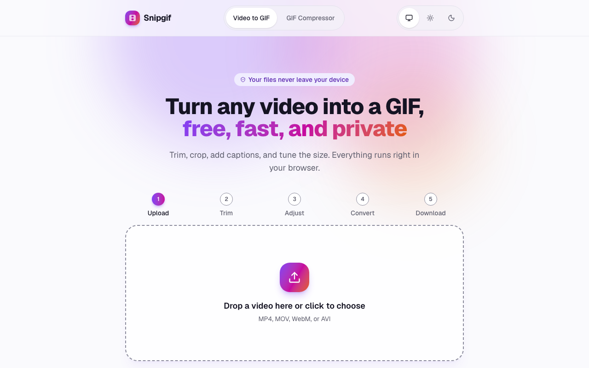
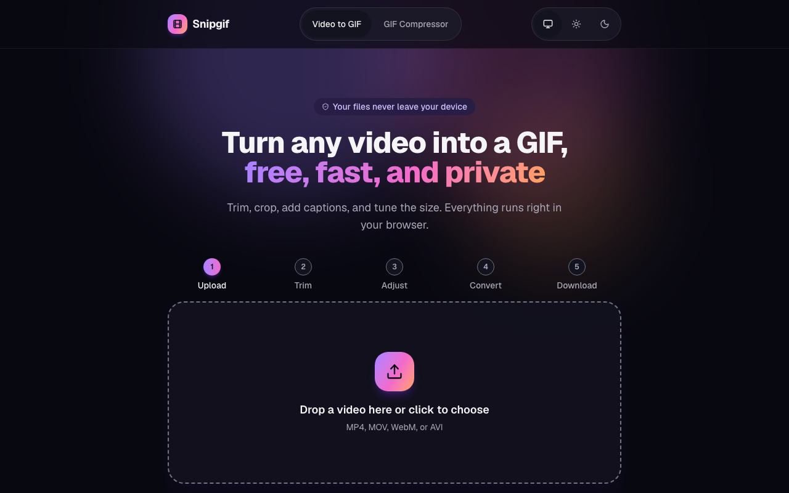
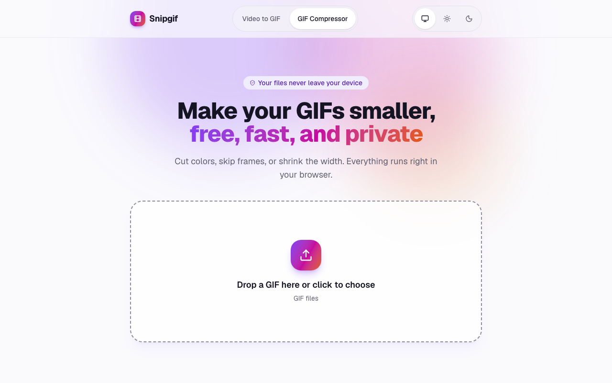

# Snipgif

Turn any video into a GIF, free, fast, and private. Snipgif converts videos and
compresses GIFs right in your browser: your files never leave your device, there
is no watermark, and there is no sign-up.

**Live:** [snipgif.vercel.app](https://snipgif.vercel.app)



| Dark theme | GIF compressor |
| :--------: | :------------: |
|  |  |

Snipgif is free and open source under the [MIT License](LICENSE). It has no ads
and no paid tier.

## What it does

**Video to GIF** (MP4, MOV, WebM, and AVI):

- Trim the clip on a timeline with a live preview (up to 30 seconds of GIF).
- Pick a preset (**Small for chat**, **Balanced**, **High quality**) or set the
  frame rate, width, and quality yourself.
- Crop to a square (1:1), landscape (16:9), or portrait (9:16) frame.
- Change the speed, play it in reverse, or make a back-and-forth boomerang.
- Add meme-style captions with a choice of font, color, and position.
- Download the GIF, copy it to the clipboard, or share it, where the browser
  supports it.

**GIF compressor:** shrink an existing GIF by reducing colors, skipping frames,
or lowering the width, and see the size before and after.

**Installable and offline:** install Snipgif as an app on your phone or
desktop. Pages work offline, and the converter works offline once its engine
has been loaded online.

There are also how-to guides at [/blog](https://snipgif.vercel.app/blog).

## Privacy

- Conversion runs on your device with [ffmpeg.wasm](https://ffmpegwasm.netlify.app/).
  Videos and GIFs are never uploaded and are gone when you close the tab.
- The ffmpeg engine (about 30 MB) is downloaded from jsDelivr only when you pick
  a file, then kept in the browser's cache.
- Analytics are optional (Google Analytics 4, only when a measurement ID is
  set). Visitors in the EEA, the UK, and Switzerland get no analytics cookies:
  Consent Mode stays denied and only cookieless measurement is sent.

## Tech stack

- [Astro](https://astro.build) static site, with React islands for the converter
  and compressor
- TypeScript, Tailwind CSS, and shadcn/ui components
- [ffmpeg.wasm](https://ffmpegwasm.netlify.app/) single-threaded core
- A hand-written service worker for offline support
- Hosted on [Vercel](https://vercel.com)

## Getting started

Requirements: Node.js 22.23.4 or newer, and npm.

```sh
git clone https://github.com/saidMounaim/snipgif.git
cd snipgif
npm install
npm run dev
```

| Command           | Action                                   |
| :---------------- | :--------------------------------------- |
| `npm install`     | Install dependencies                     |
| `npm run dev`     | Start the dev server at `localhost:4321` |
| `npm run build`   | Build the production site to `./dist/`   |
| `npm run preview` | Preview the production build locally     |

The service worker only registers in production builds, so use
`npm run build` and `npm run preview` to try the offline behavior.

## Environment variables

All variables are optional and public: they end up in the built HTML, so never
put a secret in them. Set them in a local `.env` file (git-ignored) or in your
host's project settings. A value in the wrong format is treated as unset.

| Variable                   | Purpose                                                                                                             |
| :------------------------- | :------------------------------------------------------------------------------------------------------------------ |
| `PUBLIC_SITE_URL`          | Canonical site origin for canonical URLs, the sitemap, and social cards (defaults to `https://snipgif.vercel.app`) |
| `PUBLIC_GA_MEASUREMENT_ID` | Google Analytics 4 measurement ID (`G-...`). When unset or invalid, no analytics code loads                         |

## Deploy to Vercel

1. Fork or push the repository to GitHub.
2. In Vercel, choose **Add New > Project** and import the repository.
3. Keep the detected framework preset **Astro**, the build command
   `npm run build`, and the output directory `dist`.
4. Add the environment variables above under **Settings > Environment
   Variables**, at least `PUBLIC_SITE_URL` with your Vercel or custom domain.
5. Deploy.

`vercel.json` turns on clean URLs, so `/about` serves `about.html` without a
redirect, and caches the hashed files in `/_astro/` for a year.

## Project layout

| Path               | What lives there                                                        |
| :----------------- | :---------------------------------------------------------------------- |
| `src/pages/`       | Routes: the converter, compressor, format landing pages, blog, legal pages |
| `src/components/`  | Astro components and the React converter and compressor islands        |
| `src/lib/`         | Conversion engine, settings, crop, caption, and other logic            |
| `src/content/`     | Markdown for the guides, landing pages, and legal pages                |
| `public/sw.js`     | The service worker; its precache list is filled in at build time      |
| `blueprint/`       | Project plans, specs, and the history of every feature and fix         |

## Contributing

Issues and pull requests are welcome. Before opening a pull request, run
`npm run build` and check that it passes. For questions or bug reports, open an
[issue](https://github.com/saidMounaim/snipgif/issues).

## License

[MIT](LICENSE)
